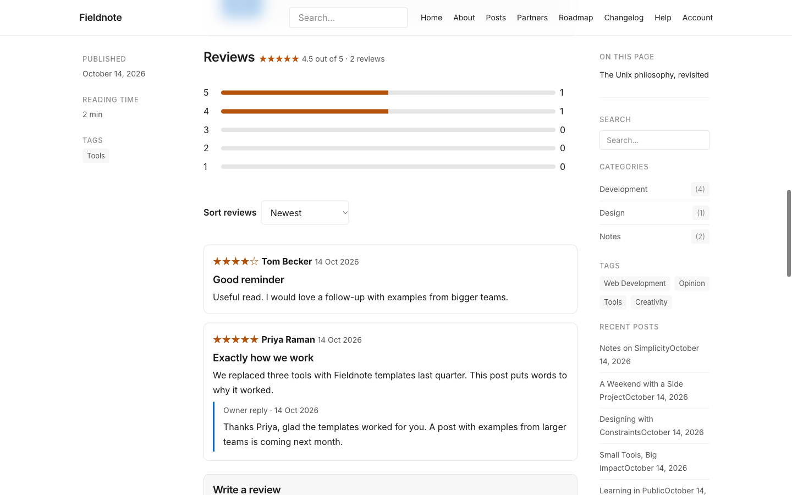
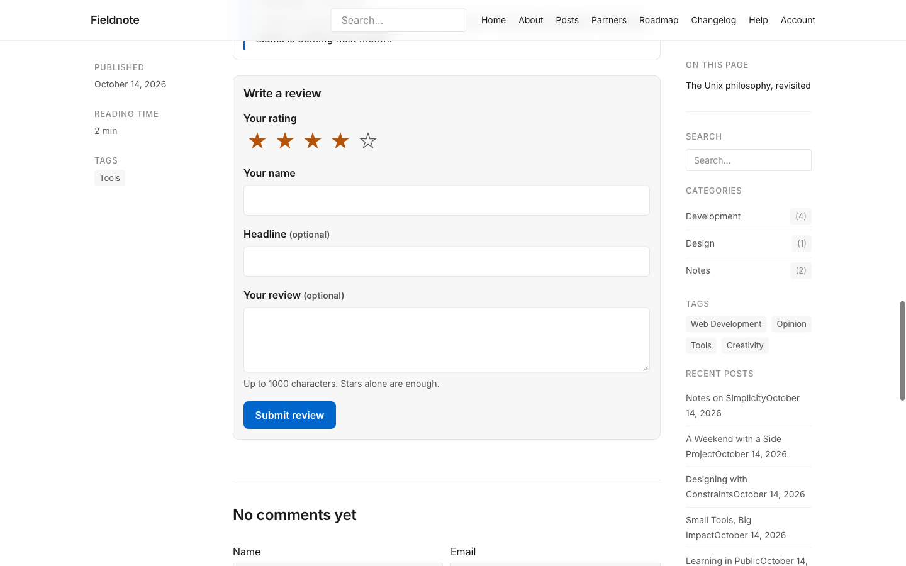
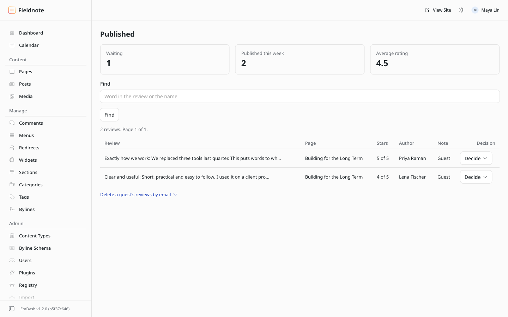
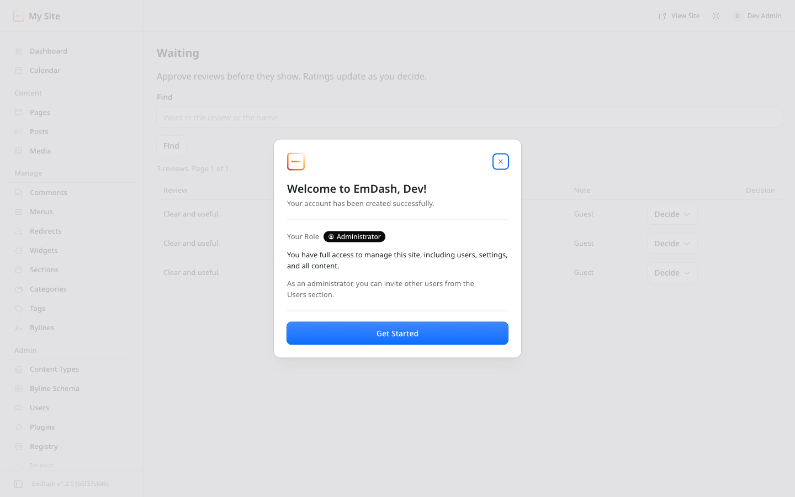
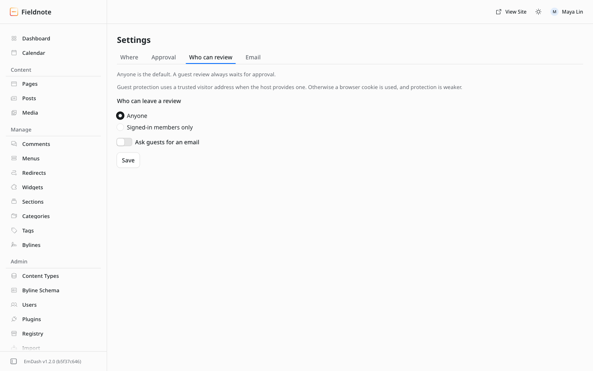

<h3 align="center">Star ratings and moderated reviews</h3>

Add star ratings and written reviews to your articles and pages. Visitors read the average and the reviews. You approve what goes live.

  <a href="https://plugins.emdashcms.com/plugins/@vapvarun.bsky.social/reviews"><b>Install from the EmDash registry</b></a>
  &nbsp;·&nbsp;
  <a href="docs/website/getting-started/introduction.md">Read the docs</a>
  &nbsp;·&nbsp;
  <a href="CHANGELOG.md">What's new</a>

## Who it is for

A blogger who wants reader feedback, a shop or course site that wants proof from buyers, or a membership site that keeps reviews to its members. If you want ratings on your EmDash site without a separate service, WB Reviews is for you.

## What you get

**For you, the site owner**

- **Ratings on any content.** Tick your own content types by name. Nothing is tied to posts.
- **Moderation.** Waiting and Published pages, search by text, and delete a guest's reviews by email.
- **Owner reply.** One public reply under a review, written in the dashboard.
- **A dashboard card** for what is waiting, plus an optional hourly email with no review text and no link.
- **Search engines see the rating.** It is added to the page as structured data.

**For your visitors and members**

- **The average, a bar for each star level and the written reviews.**
- **Stars alone or with words.** A star-only rating counts in the average and stays out of the written list.
- **Members or anyone.** Guests give a name, and an email if you ask. Guest reviews always wait for approval. One review per visitor.

  
  

## Get started

1. In your EmDash dashboard, open **Registry**, search for **WB Reviews** and install it. Your site needs a sandbox runner first, and the [install guide](docs/website/getting-started/install.md) shows how.
2. Copy the site kit into your site once, with the one command in the guide.
3. Tick the content types that get reviews under **Reviews, Settings**, then watch **Waiting**. See [Your first review](docs/website/getting-started/first-review.md).

  
  

## Good to know

- **New reviews wait for you by default.** Member reviews can go live at once only if you turn approval off. Guest reviews always wait.
- **Not core comments.** Comments stay for conversation. This adds a rating, one entry per person, an average and an owner reply.
- **Email is optional.** At most one short notice an hour, only if you turn it on and your site has mail set up.
- **Free, with no paid version.**

## Docs

- [Introduction](docs/website/getting-started/introduction.md)
- [Install](docs/website/getting-started/install.md)
- [Your first review](docs/website/getting-started/first-review.md)
- [Use cases](docs/website/getting-started/use-cases.md)
- [Where reviews show](docs/website/features/where-reviews-show.md)
- [Settings reference](docs/website/settings/settings-reference.md)
- [FAQ](docs/website/faq/faq.md) and [Troubleshooting](docs/website/troubleshooting/troubleshooting.md)

## More from Wbcom Designs for EmDash

[Learnomy](https://github.com/wbcomdesigns/emdash-learnomy) courses · [Listora](https://github.com/wbcomdesigns/emdash-listora) directories · [WB Polls](https://github.com/wbcomdesigns/emdash-polls) · [Product Roadmap](https://github.com/wbcomdesigns/emdash-roadmap) · [KnowX](https://github.com/wbcomdesigns/emdash-knowx)

Found a bug or have an idea? [Open an issue](https://github.com/wbcomdesigns/emdash-reviews/issues). Want to build on WB Reviews? Start with [CONTRIBUTING.md](CONTRIBUTING.md).

MIT licence. Made by [Wbcom Designs](https://wbcomdesigns.com).
